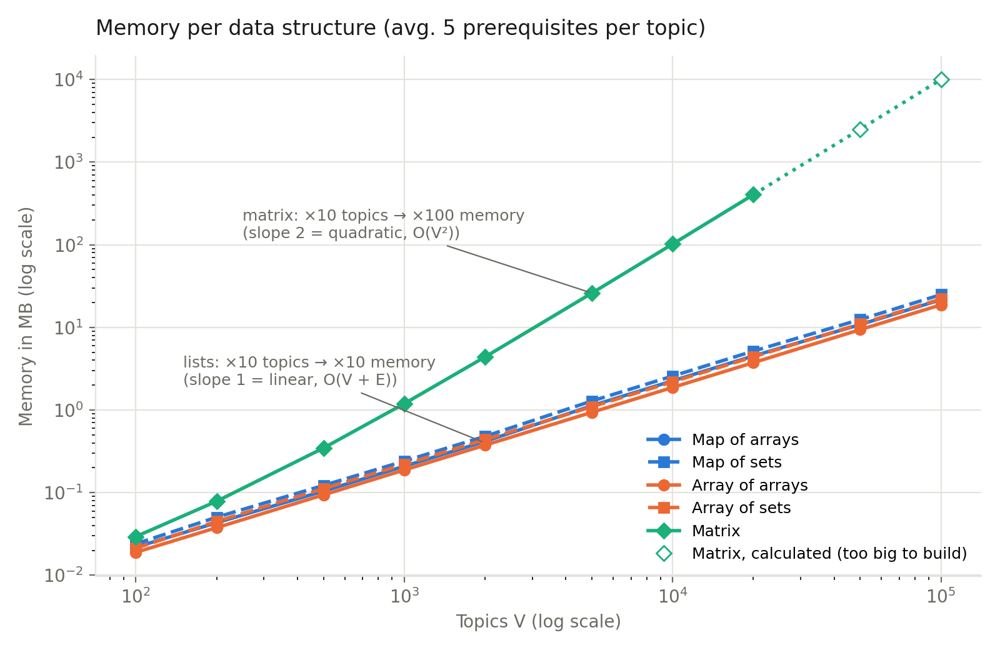
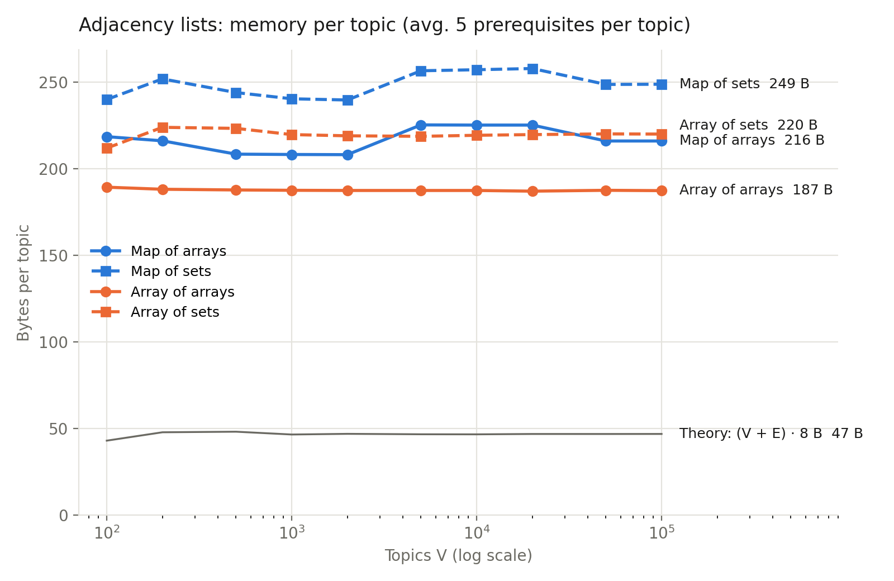
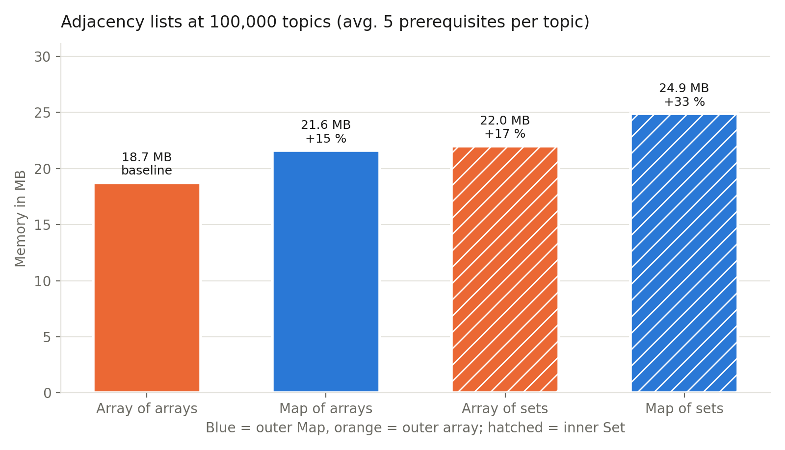

# Step 2: data structures and their memory

Loads every graph from step 1 into five data structures and measures how much memory each one takes. Step 3 runs the algorithms on the same structures.

## Run

```sh
node 2_data_structures/run.ts        # graphs with p = 5 (default); ~6 s
python3 2_data_structures/plot.py
```

Add `--p 3` (or any other p) to both to use the graphs generated with `node 1_generation/run.ts --p 3`.

## The five structures

Each one answers one question, **"what does topic X require?"** (`prerequisites(id)`). That's all DFS and BFS need.

Four of them are adjacency lists, varied in two independent choices:

| | Inner: array | Inner: Set |
|---|---|---|
| **Outer: Map** | `mapOfArrays.ts`: the course's "dictionary of lists" | `mapOfSets.ts` |
| **Outer: array** | `arrayOfArrays.ts` | `arrayOfSets.ts` |

- The **outer** container decides how X's prerequisites are **found**: hash X (Map, session 5) or jump straight to position X (array, session 2).
- The **inner** container decides how they are **stored**: a plain list, or a small hash table per topic (Set). A Set makes "does X require Y directly?" O(1), but DFS and BFS never ask that; they always walk through all of X's prerequisites.

The fifth is the **adjacency matrix** (`matrix.ts`): one row of V cells per topic, 1 byte per cell. Finding X's prerequisites means scanning the whole row. It is built up to 20,000 topics (400 MB). For 50,000 (2.5 GB) and 100,000 (10 GB) topics the size is only calculated.

| Structure | Memory (theory) | Find X's prerequisites |
|---|---|---|
| All four lists | O(V + E) | O(1) to find the list, then O(degree) to walk it |
| Matrix | O(V²) | O(V): scan the row |

`structures.ts` lists all five; `structures.test.ts` checks that all five return the same prerequisites for every topic.

## How the memory is measured (`run.ts`)

1. Run the garbage collector and read the memory in use (`heapUsed` + `arrayBuffers`; the matrix rows live in the second).
2. Build the structure.
3. Run the garbage collector again and read again. The difference is the structure's size.

Each measurement is repeated 5 times and the median kept. Repeated runs give the same numbers.

Next to each measurement, `run.ts` writes a **theory estimate**: (V + E) · 8 bytes for the lists (one 8-byte number per topic and per edge), V² bytes for the matrix.

## Results (p = 5)

`results/memory_p5.csv` has every row. A selection:

| Topics V | Array of arrays | Map of arrays | Array of sets | Map of sets | Matrix |
|---:|---:|---:|---:|---:|---:|
| 100 | 0.02 MB | 0.02 MB | 0.02 MB | 0.02 MB | 0.03 MB |
| 1,000 | 0.19 MB | 0.21 MB | 0.22 MB | 0.24 MB | 1.19 MB |
| 10,000 | 1.87 MB | 2.25 MB | 2.19 MB | 2.57 MB | 101.9 MB |
| 20,000 | 3.74 MB | 4.51 MB | 4.40 MB | 5.16 MB | 403.8 MB |
| 100,000 | 18.7 MB | 21.6 MB | 22.0 MB | 24.9 MB | *10,000 MB (calculated)* |







On the log-log chart the four lists look almost identical. A constant factor of at most 1.33 is a shift of only 0.12 of one tick spacing on a log scale. The two charts above show the differences on a linear scale.

## What it shows

1. **The matrix grows quadratically, the lists linearly.** ×10 topics gives ×10 memory for the lists (10,000 → 100,000: 1.87 → 18.7 MB) and close to ×100 for the matrix (2,000 → 20,000: 4.4 → 404 MB). On the log-log chart that is a slope of 1 vs. 2, matching O(V + E) vs. O(V²) from session 6.
2. **At 20,000 topics the matrix needs 80–110× more than the lists**, and at 100,000 topics it would need 10 GB. At 100 topics the difference hardly matters (0.03 vs. 0.02 MB).
3. **All four lists cost a roughly constant amount per topic** (flat lines in the second chart), which is what "linear" means. At 100,000 topics:
   - Array of arrays: 187 B per topic. This is the cheapest at every size.
   - Map of arrays: +15 %, because the Map adds a hash table on top.
   - Array of sets: +17 %, because every topic gets its own small hash table.
   - Map of sets: +33 %, both costs together. This is the most expensive at every size.

   The two middle ones swap places depending on the size, because of the Map steps (point 5).
4. **The lists need about 4× more than the theory estimate** (187 B vs. 47 B per topic). About half of that is spare room. `push` reserves space for more entries than a topic ends up with (session 2, dynamic arrays). The same lists copied at exact size need 95 B per topic. The rest is the fixed cost of each array object.
5. **The Map lines step up and down** (e.g. 208 → 225 B per topic between 2,000 and 5,000 topics). A Map doubles its table when it gets full (session 5, "Load factor and resizing"). Just after a doubling the table is half empty: a Map of 4,000 entries takes ~29 B per entry, one of 5,000 entries ~46 B.

## Limits

- Measured in Node.js (V8). The exact byte counts depend on the JavaScript engine; the growth (linear vs. quadratic) does not.
- The Map uses topic ids as keys, not names. A real app might look topics up by name; with ids, Map vs. array differ only in how the list is found.
