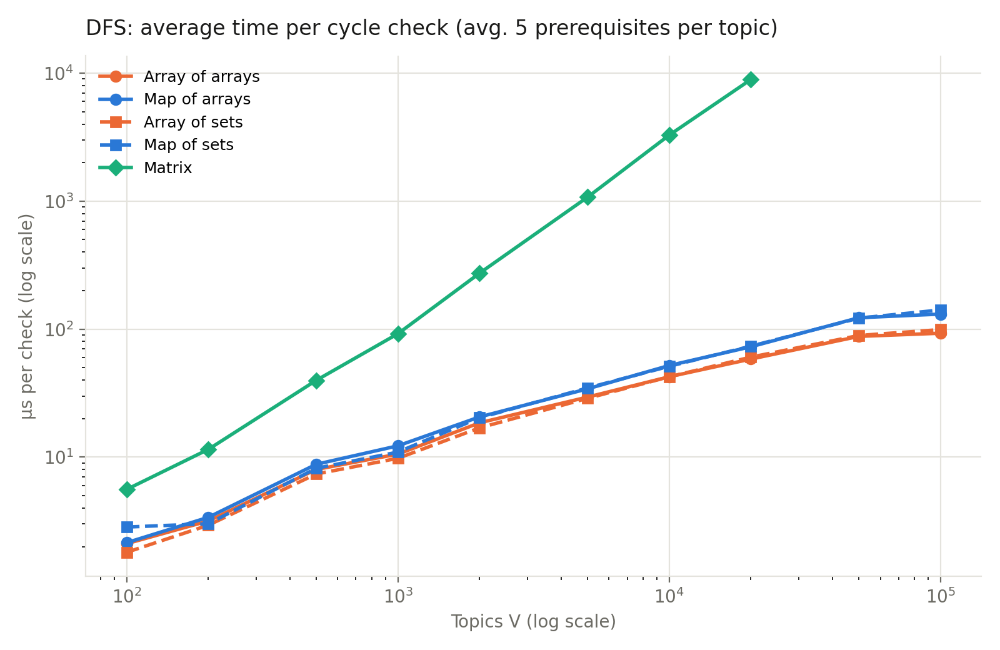
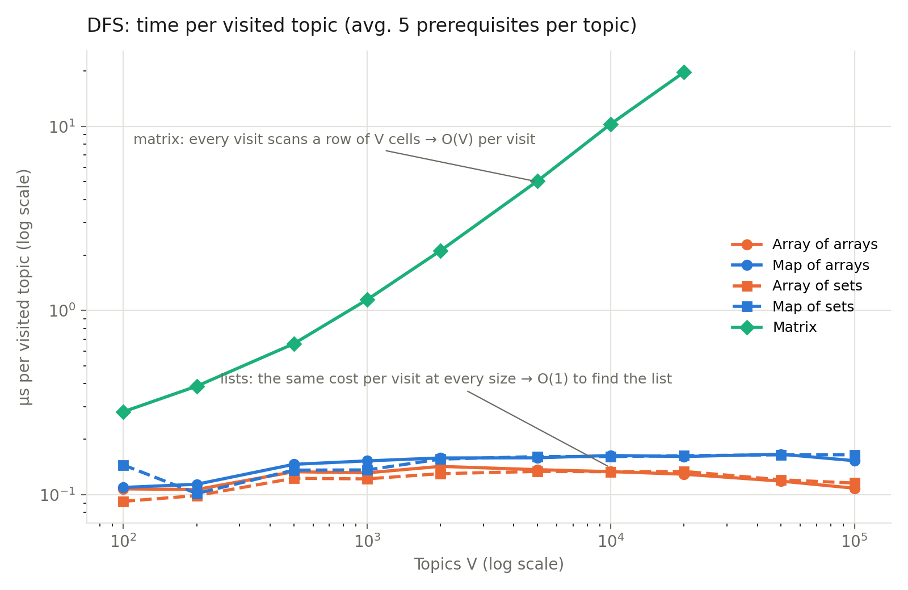
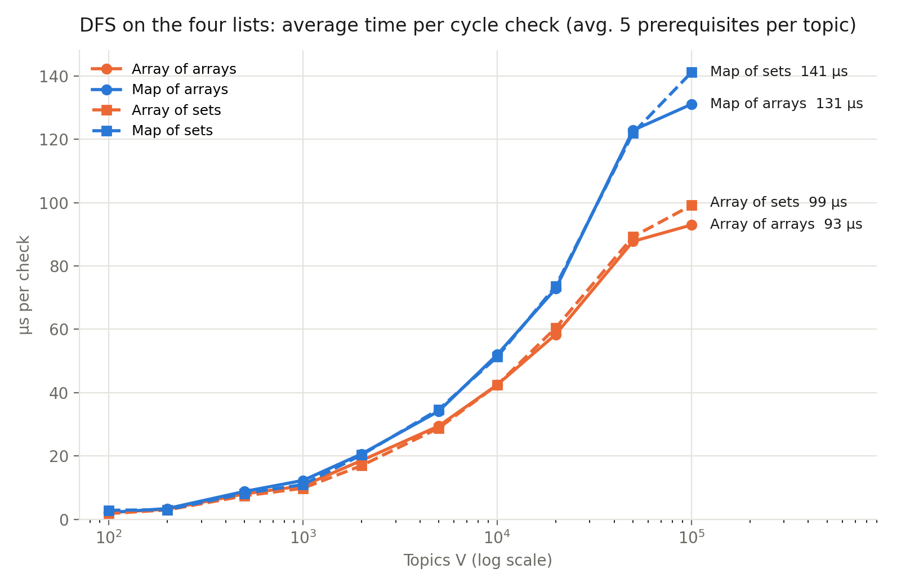
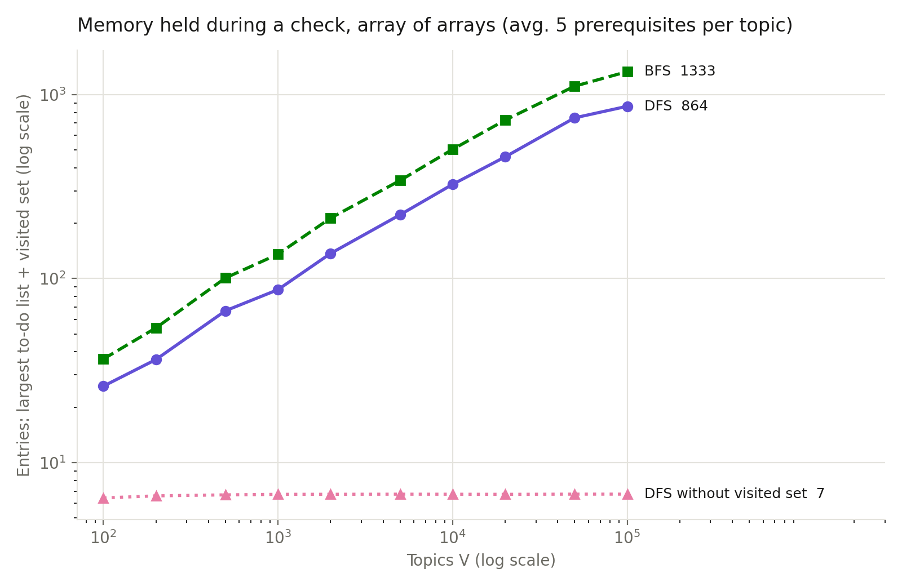
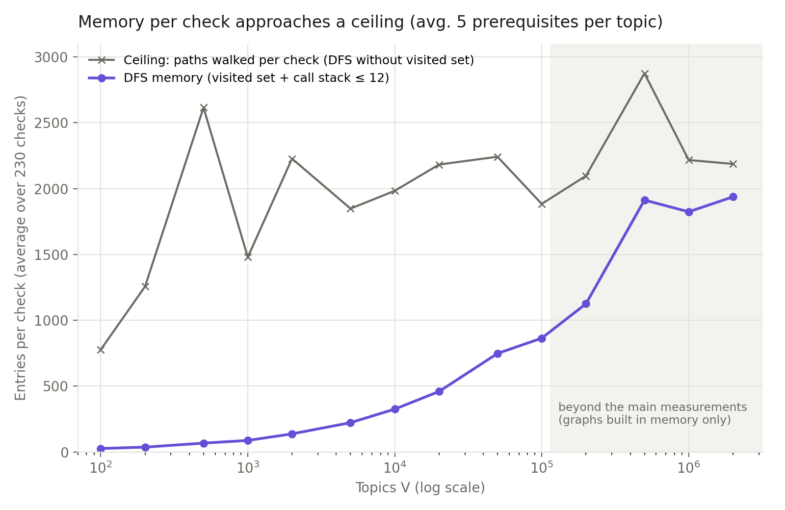
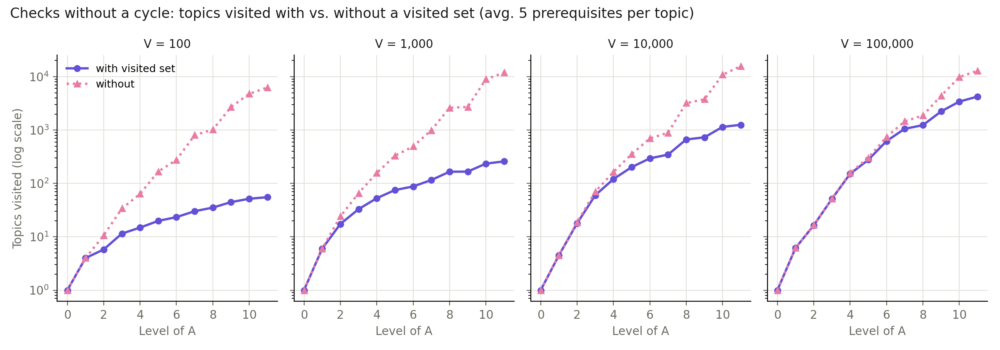
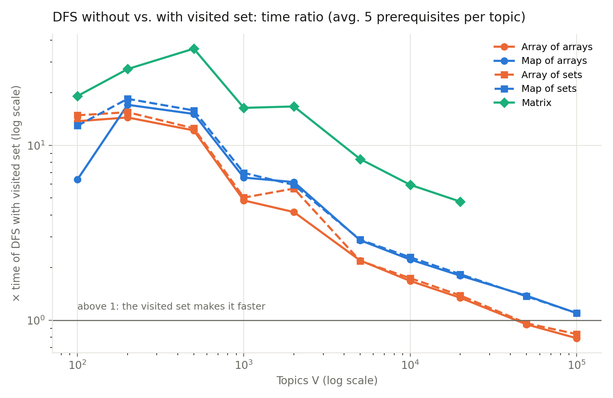

# Step 3: algorithms, time and memory

Runs DFS, BFS and DFS without a visited set on all five structures from step 2, and measures time and memory for each search.

## Run

```sh
node 3_algorithms/run.ts          # graphs with p = 5 (default); ~85 s
python3 3_algorithms/plot.py
```

Add `--p 3` (or any other p) to both to use other graphs from step 1.

## The task: the cycle check

A new prerequisite "B requires A" is about to be added. It creates a cycle exactly when **A already reaches B** (A requires … requires B). Then B → A → … → B would be a loop. So every check is a search **from A, looking for B**:

- **B found:** cycle, so the edge is rejected. The search stops as soon as it reaches B.
- **B not found:** no cycle, so the edge is safe. The search had to walk everything A reaches to be sure. This is the expensive case.

Example in `example_cs.json`: "Variables requires Merge Sort"? Merge Sort → Recursion → Functions → **Variables**: cycle.

## Files

| File | What |
|---|---|
| `dfs.ts` | DFS, recursive like the course (session 7); the call stack is the stack |
| `bfs.ts` | BFS with a queue (array + read position, because `shift()` is O(n)) |
| `dfsNoVisited.ts` | The same DFS without the visited set; stops at 1,000,000 visits as a safety cap (never reached with p = 5) |
| `algorithms.ts` | The shared result type, the list of the three, `createsCycle()` |
| `checks.ts` | Picks the checks for a graph (below) |
| `run.ts` | Runs every graph × structure × algorithm × check, writes `results/checks_p5.csv` |
| `plot.py` | The six charts below, plus the two summary CSVs with the averages behind them |
| `results/summary_p5.csv` | One row per size × structure × algorithm, averaged over its 230 checks (columns below) |
| `results/summary_by_level_p5.csv` | The same, split by level of A and cycle / no cycle (10 checks per row) |
| `ceiling.ts` | Extra experiment: memory per check on graphs up to 2,000,000 topics (`node 3_algorithms/ceiling.ts`, ~10 s) → `results/ceiling_p5.csv`, chart `ceiling_p5.png` |
| `algorithms.test.ts` | Hand-checked cases on `example_cs.json`, plus every structure × algorithm on a generated graph against the known answers |

All three use a `Set<number>` as the visited set on every structure, so differences between structures come only from the structure.

## The checks (`checks.ts`)

For each graph: per level of A (0–11), 10 checks **with** a cycle (B is a topic A reaches) and 10 **without** (B is a topic A doesn't reach). A level-0 topic reaches nothing, so level 0 has only checks without a cycle, which makes **230 checks per graph**. They're spread over the levels because the level of A decides how much a search walks: from level 0 it reaches nothing; from level 11 up to thousands of topics. The checks use a fixed seed, so every structure and algorithm gets the same ones.

## What is measured

- **Time:** each check runs 5 times (matrix: 3) and the median is kept, after 20 untimed warm-up checks so JavaScript has compiled the code. One check takes microseconds, which is too short to time reliably once.
- **Memory**, counted in entries inside the search, so it's exact and the same on every run:
  - **to-do list at its largest:** deepest call stack (DFS) or most topics waiting in the queue (BFS);
  - **visited set:** topics in it at the end (it only grows, so that's its peak);
  - `memoryEntries` = both added. ×8 bytes gives a rough size.
- **Work:** topics visited and edges looked at.

Every answer is checked against the known one; a wrong answer stops the run.

The matrix runs up to 20,000 topics (its limit from step 2). Everything else runs on all sizes up to 100,000.

## How the charts average

Two steps: per check, the **median** of its 5 (or 3) runs is stored in `checks_p5.csv`; per chart point, the **mean** over the checks is taken. The mean is the total time for all 230 checks ÷ 230, so it's the average cost of a check in this mix: equal numbers per level, half with and half without a cycle. Expensive checks (high level, no cycle) dominate it. The median over checks is in the summary too, for comparison.

Columns of `results/summary_p5.csv`:

| Column | Meaning | Used in chart |
|---|---|---|
| `checks` | number of checks averaged (230) | |
| `meanUs` | mean time per check | `time_all`, `time_lists` |
| `medianUs` | median time per check (a "typical" check) | |
| `meanUsCycle`, `meanUsNoCycle` | mean time, only checks with / without a cycle | |
| `meanVisits`, `meanEdges` | mean topics visited / edges looked at | |
| `usPerVisit` | `meanUs` ÷ `meanVisits` (total time ÷ total visits) | `time_per_visit` |
| `meanMaxTodo`, `maxMaxTodo` | largest stack / queue: mean and maximum over the checks | |
| `meanVisitedSet` | mean size of the visited set | |
| `meanMemoryEntries` | mean of to-do list + visited set | `memory_algorithms` |
| `timeVsDfs` | `meanUs` ÷ DFS's `meanUs` on the same structure (1 for DFS) | `no_visited_time` |

`results/summary_by_level_p5.csv` has `meanUs`, `meanVisits`, `meanEdges`, `meanMaxTodo`, `meanVisitedSet` and `meanMemoryEntries` per level and cycle / no cycle. `visited_by_level` uses its `meanVisits` for the rows with `cycle = false`.

## Results (p = 5)

### 1. The matrix gets slower per step as the graph grows; the lists don't





| Topics V | Array of arrays: µs per visited topic | Matrix: µs per visited topic |
|---:|---:|---:|
| 100 | 0.11 | 0.28 |
| 1,000 | 0.13 | 1.15 |
| 10,000 | 0.13 | 10.3 |
| 20,000 | 0.13 | 19.7 |

- **Lists:** a visit costs about the same at every size. Finding the list is O(1), so a search is O(V + E) of the part it reaches.
- **Matrix:** a visit costs more the bigger the graph. To find a topic's prerequisites it scans the whole row, V cells, even though only ~5 are set. ×10 topics gives ×9 per visit. At 20,000 topics a check takes **150× longer** than on the array of arrays (8.9 ms vs. 58 µs).
- The time per check also grows for the lists (2 → 93 µs), but only because a search reaches more topics in a bigger graph (20 → 857 visits on average), not because each step gets slower.

### 2. The four lists: the outer container matters, the inner one hardly does



DFS at 100,000 topics, average per check:

| | µs | vs. array of arrays |
|---|---:|---:|
| Array of arrays | 93 | |
| Array of sets | 99 | +7 % |
| Map of arrays | 131 | +41 % |
| Map of sets | 141 | +52 % |

- **Outer Map vs. array: +41 %.** The search looks up a topic's list once per visit; hashing the id costs more than jumping to position id.
- **Inner Set vs. array: +7 %.** The search walks through *all* prerequisites, which is O(degree) for both; the Set's O(1) "is Y in here?" is never used.
- This matches step 2's memory result: the array of arrays is cheapest, the Map of sets most expensive.

### 3. DFS vs. BFS: same time, BFS holds more in memory



At 100,000 topics (array of arrays, average per check):

| | µs | Largest to-do list (avg / max) | Visited set (avg) | Memory entries (avg) |
|---|---:|---:|---:|---:|
| DFS | 93 | 6.7 / 12 | 857 | 864 |
| BFS | 105 | 342 / 1,918 | 991 | 1,333 |
| DFS without visited set | 73 | 6.7 / 12 | 0 | 7 |

- **Time:** about the same. On the lists from 1,000 topics up, BFS is between 3 % faster and 14 % slower than DFS; below that, the times are too short to compare reliably. Both visit the same topics; for "is B reachable at all?" the order doesn't matter. BFS's slight extra cost is the queue bookkeeping.
- **To-do list:** DFS's call stack is never deeper than the longest chain (12). BFS's queue holds a whole "layer" of prerequisites at once, up to 1,918 topics.
- **Visited set:** in both it's the larger part and grows with the reachable part of the graph. BFS's is a bit bigger, because it marks topics when they enter the queue.
- **The memory is the same on every structure** for the four lists (same visit order, same `Set`); on the matrix it differs slightly, because the matrix returns prerequisites in id order.

### 3b. The memory per check levels off: the number of paths is a ceiling

In the worst case, DFS and BFS need O(V) memory, since the visited set could hold every topic. In these graphs it grows much more slowly (about ×3 per ×10 topics up to 100,000), and the growth slows down. The reason: a check can't reach more **different topics** than there are **paths** from A, and DFS without a visited set walks exactly those paths. The number of paths depends on the depth (12 levels) and p, not on V.

`ceiling.ts` runs the same kind of checks on graphs up to 2,000,000 topics (DFS, BFS and DFS without visited set on the array of arrays, counts only, graphs built in memory):



| Topics V | DFS memory (entries) | Different topics reached | Paths per check | Reached / paths | BFS memory |
|---:|---:|---:|---:|---:|---:|
| 10,000 | 325 | 318 | 1,983 | 16 % | 504 |
| 100,000 | 864 | 857 | 1,884 | 46 % | 1,333 |
| 200,000 | 1,125 | 1,119 | 2,097 | 53 % | 1,769 |
| 500,000 | 1,913 | 1,906 | 2,875 | 66 % | 2,587 |
| 1,000,000 | 1,824 | 1,817 | 2,217 | 82 % | 2,891 |
| 2,000,000 | 1,937 | 1,931 | 2,188 | 88 % | 2,939 |

- **The paths stay at about 2,000 per check** at every size (they vary between graphs because each graph gets its own random checks).
- **The topics reached grow towards that ceiling:** 16 % of the paths at 10,000 topics, 88 % at 2,000,000. In a large graph, the paths from A rarely meet again, so from A's point of view the graph looks more and more like a tree.
- **From about 500,000 topics on, DFS's memory stays at about 1,900 entries**, although the graph grows 4× more. BFS levels off the same way, at about 2,900 (higher, because its queue is counted on top of the visited set, so it isn't shown against the ceiling in the chart).
- **In a real curriculum this would happen much earlier:** subject areas (maths topics don't require history topics) would limit a check to its own area plus shared foundations. Adding an unrelated area would grow V without changing the cost of existing checks at all. Our generator has no subject areas, so the measured growth is larger than in a real curriculum.

### 4. Cycle or no cycle

Average at 100,000 topics, DFS on the array of arrays: **58 µs with a cycle, 125 µs without.** With a cycle the search stops at B; without one it must walk everything A reaches. Most new prerequisites are valid, so the common case is the expensive one.

### 5. The visited set: a big win on small graphs, a small one on large graphs



Checks without a cycle, A on level 11, average topics visited:

| Topics V | With visited set | Without | Factor |
|---:|---:|---:|---:|
| 100 | 55 | 6,284 | 114× |
| 1,000 | 259 | 11,881 | 46× |
| 10,000 | 1,255 | 15,789 | 13× |
| 100,000 | 4,234 | 12,938 | 3× |

- **Without a visited set, DFS walks every path** from A. With it, it walks every topic once. A topic reached by 100 paths is walked 100 times, like naive recursive Fibonacci (session 4). The visited set does what memoization does there.
- **The number of paths hardly depends on the size** (about 6,000–16,000 from level 11). It depends on the depth (11 levels) and the number of prerequisites per topic (5).
- **The number of different topics grows with the size.** In a small graph, the paths keep meeting at the same few topics, so the visited set saves a lot. In a large graph they spread out over many different topics, so there's less to save.



- **In time** the effect is smaller still, because every visit **with** a visited set also pays for `has` and `add`. On the lists, DFS without a visited set goes from 14× slower (100 topics) to 0.8×, slightly **faster**, at 100,000 topics.
- **On the matrix** each visit is expensive (a row scan), so every visit saved counts. It stays 5–36× slower without the visited set.
- **Memory:** without a visited set, DFS holds at most 12 entries (its call stack) instead of hundreds or thousands.

So, on a DAG, the visited set trades memory for time. It also does what session 7 introduces it for: on a graph that already has a cycle (a bug), DFS without it would loop until the cap.

## Limits

- Times are from one machine (Node.js / V8) and include the small cost of counting visits and memory, the same for every algorithm.
- The visited-set results depend on the graph shape: with a deeper curriculum than 11 levels, the number of paths, and with it the cost without a visited set, would grow exponentially.
- Average times mix cheap checks (low levels, cycle found early) with expensive ones; `results/checks_p5.csv` has every single check.
